# CSS-ASSIGNMENT

Welcome to my **CSS Assignment** repository! This project showcases a collection of 16 front-end web assignments built using **HTML5** and **CSS3**, focusing on modern layouts with **CSS Grid**, **Flexbox**, responsive design, and pixel-perfect UI clones.

> 💡 **Tip:** Click on any link in the table or click directly on any screenshot below to open and view the live web page in your browser.

---

## 🔗 Direct Preview Links

| # | Assignment Name | Live Web Page | Source Code |
|---|---|---|---|
| 01 | Amazon Clone | [🌐 Open Web Page](https://amit-kumar-08.github.io/CSS-ASSIGNMENT/Amazon/amazon.html) | [💻 View Code](./Amazon/amazon.html) |
| 02 | Netflix Clone | [🌐 Open Web Page](https://amit-kumar-08.github.io/CSS-ASSIGNMENT/Netflix/netflix.html) | [💻 View Code](./Netflix/netflix.html) |
| 03 | YouTube Clone | [🌐 Open Web Page](https://amit-kumar-08.github.io/CSS-ASSIGNMENT/Youtube/youtube.html) | [💻 View Code](./Youtube/youtube.html) |
| 04 | Spotify Clone | [🌐 Open Web Page](https://amit-kumar-08.github.io/CSS-ASSIGNMENT/Spotify/spotify.html) | [💻 View Code](./Spotify/spotify.html) |
| 05 | iOS Calculator | [🌐 Open Web Page](https://amit-kumar-08.github.io/CSS-ASSIGNMENT/calculator/cal.html) | [💻 View Code](./calculator/cal.html) |
| 06 | Cricket Scorecard App | [🌐 Open Web Page](https://amit-kumar-08.github.io/CSS-ASSIGNMENT/Cricket_app/cricket.html) | [💻 View Code](./Cricket_app/cricket.html) |
| 07 | Kidz World Toy Store | [🌐 Open Web Page](https://amit-kumar-08.github.io/CSS-ASSIGNMENT/kidz-world/kidz.html) | [💻 View Code](./kidz-world/kidz.html) |
| 08 | Classic Ludo Board | [🌐 Open Web Page](https://amit-kumar-08.github.io/CSS-ASSIGNMENT/Ludo/ludo.html) | [💻 View Code](./Ludo/ludo.html) |
| 09 | Sudoku 9x9 Grid | [🌐 Open Web Page](https://amit-kumar-08.github.io/CSS-ASSIGNMENT/sudoku/sudoku.html) | [💻 View Code](./sudoku/sudoku.html) |
| 10 | Superwars Arena | [🌐 Open Web Page](https://amit-kumar-08.github.io/CSS-ASSIGNMENT/Suparwars/superwar.html) | [💻 View Code](./Suparwars/superwar.html) |
| 11 | Super Over Cricket Match | [🌐 Open Web Page](https://amit-kumar-08.github.io/CSS-ASSIGNMENT/Superover/superover.html) | [💻 View Code](./Superover/superover.html) |
| 12 | Question 1: Navigation Bar | [🌐 Open Web Page](https://amit-kumar-08.github.io/CSS-ASSIGNMENT/Q1/q1.html) | [💻 View Code](./Q1/q1.html) |
| 13 | Question 2: Product Cards Grid | [🌐 Open Web Page](https://amit-kumar-08.github.io/CSS-ASSIGNMENT/Q2/q2.html) | [💻 View Code](./Q2/q2.html) |
| 14 | Question 3: Dashboard Layout | [🌐 Open Web Page](https://amit-kumar-08.github.io/CSS-ASSIGNMENT/Q3/q3.html) | [💻 View Code](./Q3/q3.html) |
| 15 | Question 4: Team Member Profiles | [🌐 Open Web Page](https://amit-kumar-08.github.io/CSS-ASSIGNMENT/Q4/q4.html) | [💻 View Code](./Q4/q4.html) |
| 16 | Question 5: Web App Layout | [🌐 Open Web Page](https://amit-kumar-08.github.io/CSS-ASSIGNMENT/Q5/q5.html) | [💻 View Code](./Q5/q5.html) |

---

## 🖼️ Assignment Web Pages

### 1. Amazon Clone
<a href="https://amit-kumar-08.github.io/CSS-ASSIGNMENT/Amazon/amazon.html">
  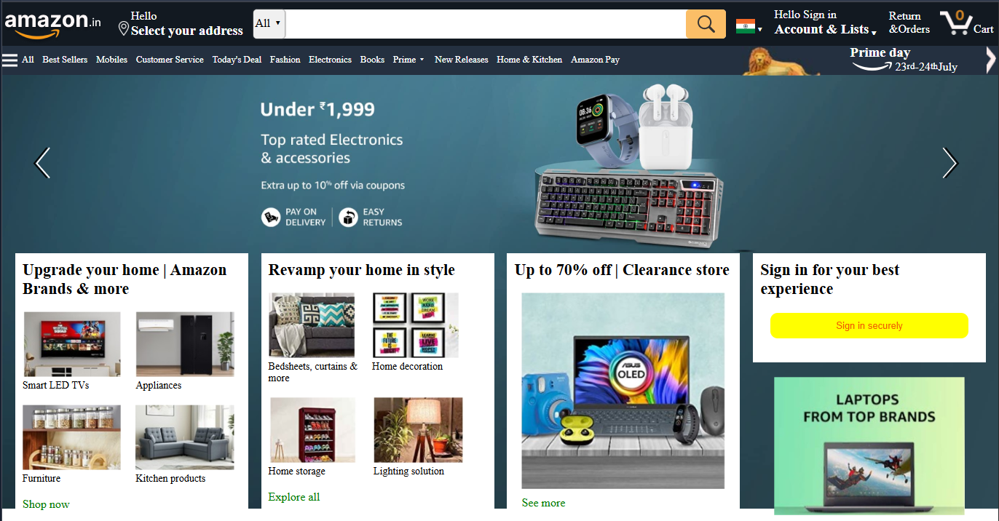
</a>

---

### 2. Netflix Clone
<a href="https://amit-kumar-08.github.io/CSS-ASSIGNMENT/Netflix/netflix.html">
  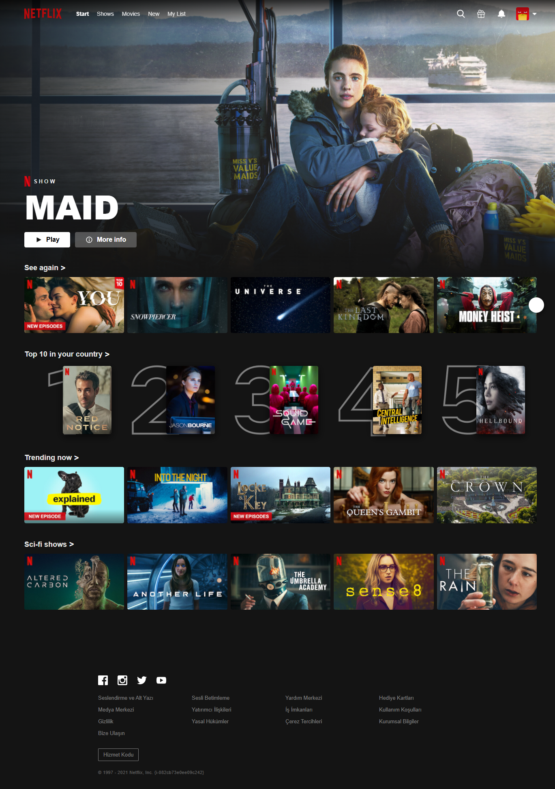
</a>

---

### 3. YouTube Clone
<a href="https://amit-kumar-08.github.io/CSS-ASSIGNMENT/Youtube/youtube.html">
  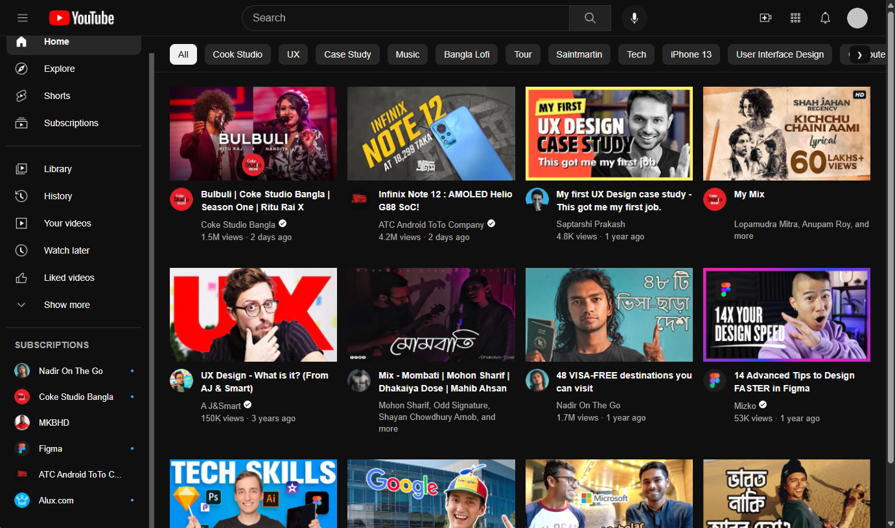
</a>

---

### 4. Spotify Clone
<a href="https://amit-kumar-08.github.io/CSS-ASSIGNMENT/Spotify/spotify.html">
  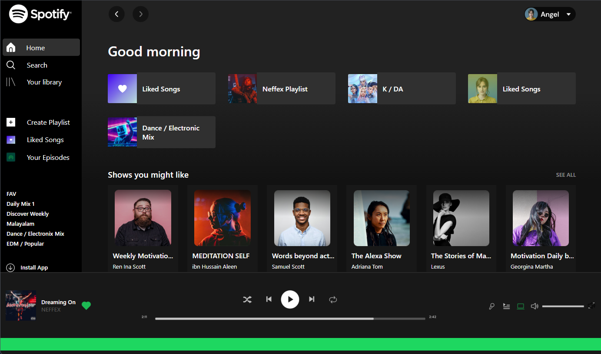
</a>

---

### 5. iOS Calculator
<a href="https://amit-kumar-08.github.io/CSS-ASSIGNMENT/calculator/cal.html">
  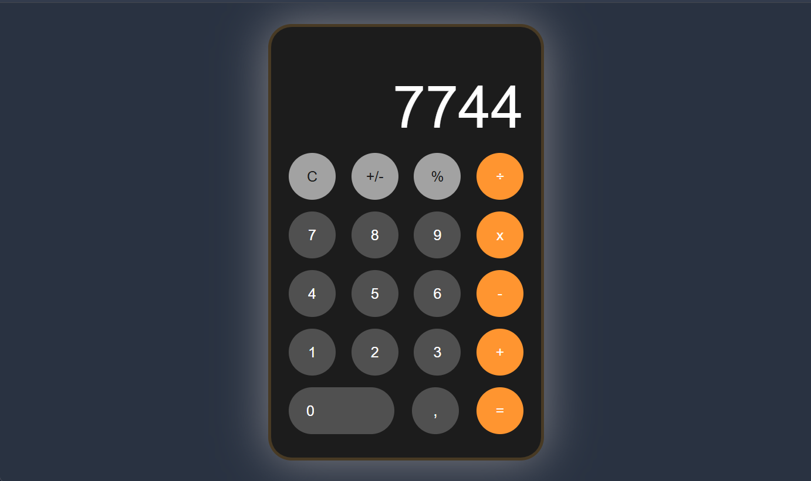
</a>

---

### 6. Cricket Scorecard App
<a href="https://amit-kumar-08.github.io/CSS-ASSIGNMENT/Cricket_app/cricket.html">
  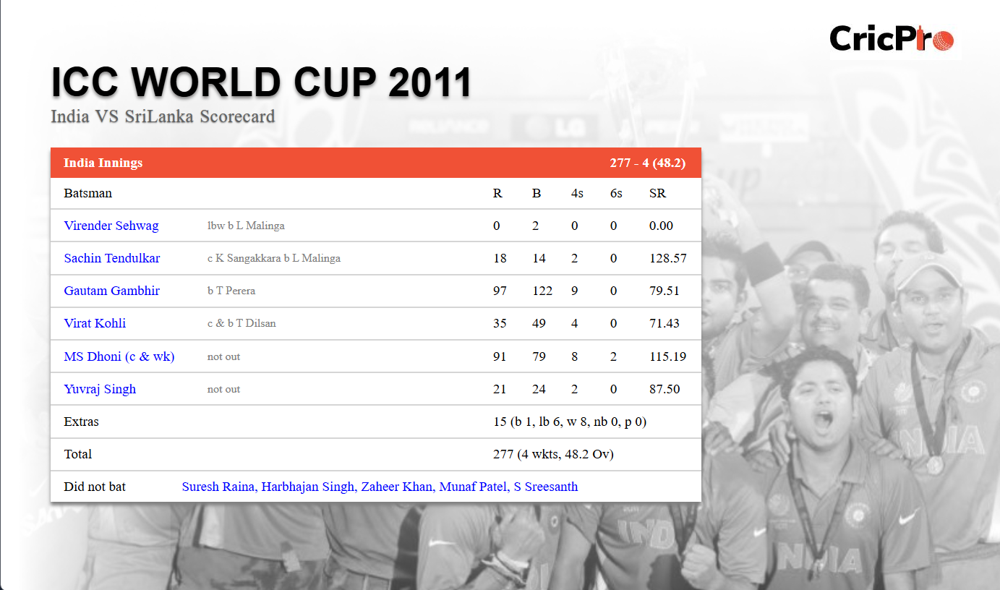
</a>

---

### 7. Kidz World Toy Store
<a href="https://amit-kumar-08.github.io/CSS-ASSIGNMENT/kidz-world/kidz.html">
  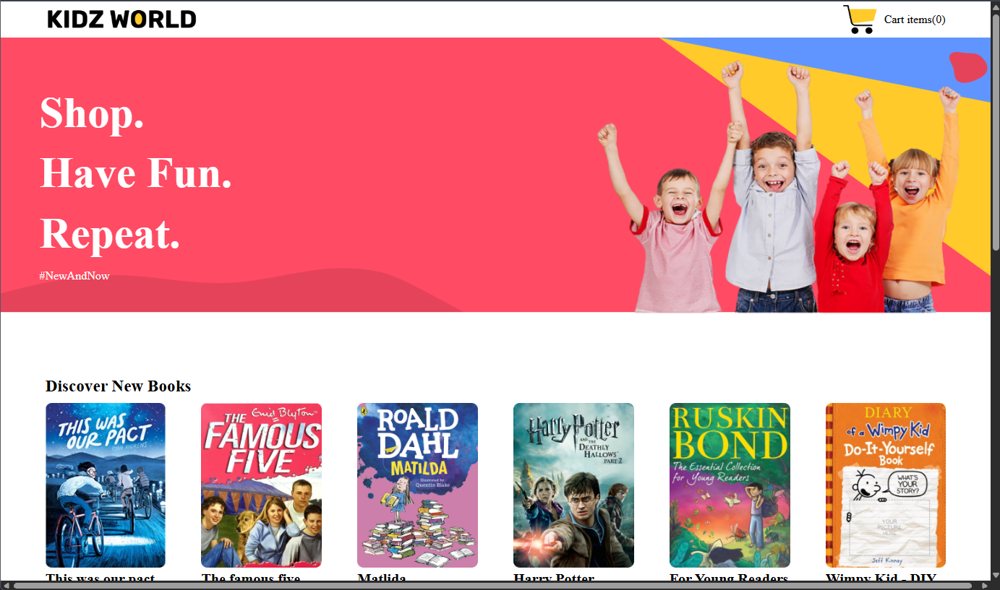
</a>

---

### 8. Classic Ludo Board
<a href="https://amit-kumar-08.github.io/CSS-ASSIGNMENT/Ludo/ludo.html">
  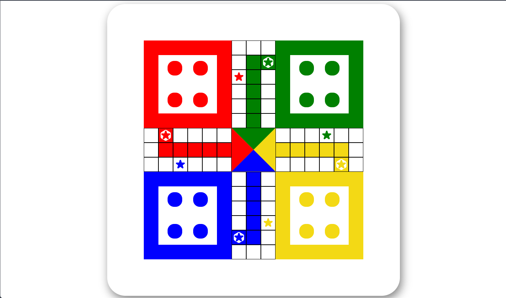
</a>

---

### 9. Sudoku 9x9 Grid
<a href="https://amit-kumar-08.github.io/CSS-ASSIGNMENT/sudoku/sudoku.html">
  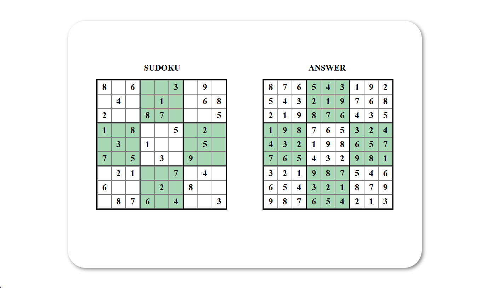
</a>

---

### 10. Superwars Arena
<a href="https://amit-kumar-08.github.io/CSS-ASSIGNMENT/Suparwars/superwar.html">
  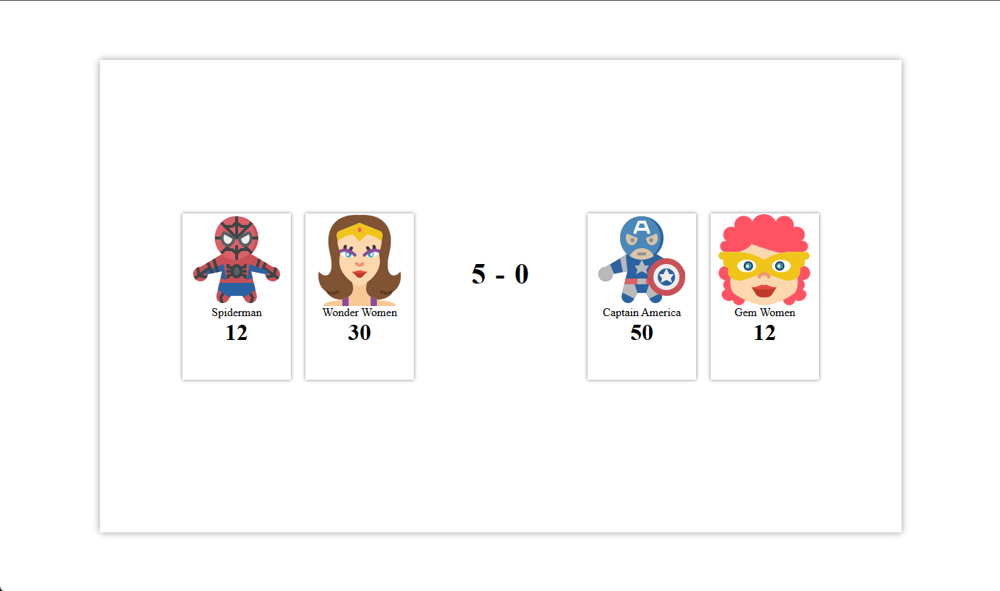
</a>

---

### 11. Super Over Cricket Match
<a href="https://amit-kumar-08.github.io/CSS-ASSIGNMENT/Superover/superover.html">
  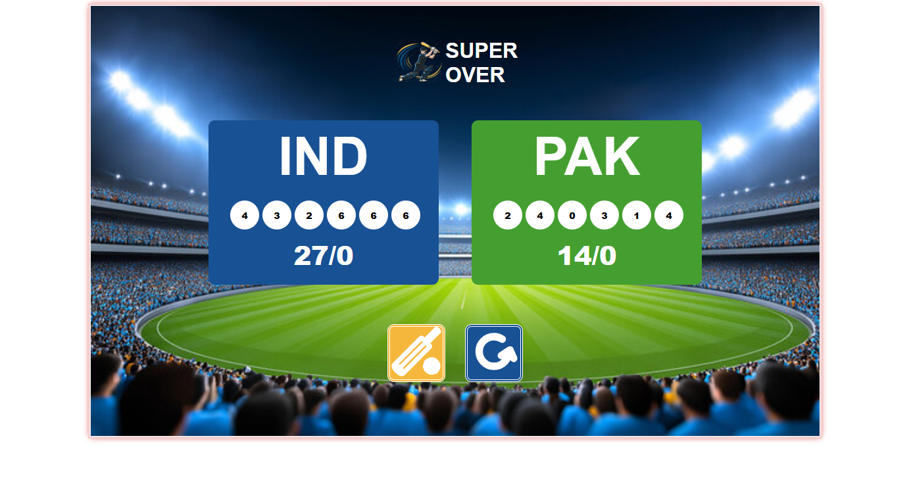
</a>

---

### 12. Question 1: Navigation Bar
<a href="https://amit-kumar-08.github.io/CSS-ASSIGNMENT/Q1/q1.html">
  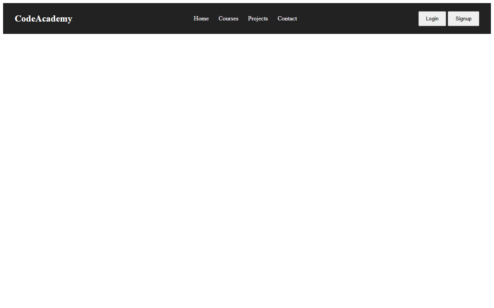
</a>

---

### 13. Question 2: Product Cards Grid
<a href="https://amit-kumar-08.github.io/CSS-ASSIGNMENT/Q2/q2.html">
  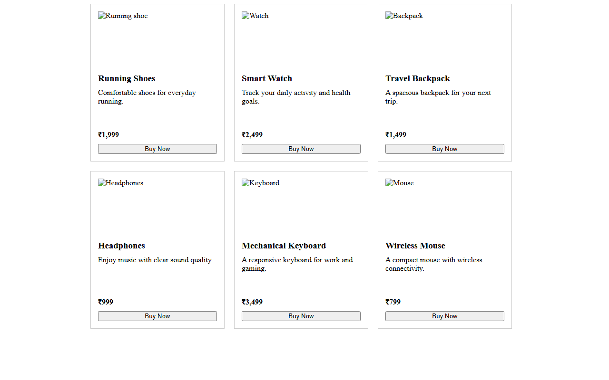
</a>

---

### 14. Question 3: Dashboard Layout
<a href="https://amit-kumar-08.github.io/CSS-ASSIGNMENT/Q3/q3.html">
  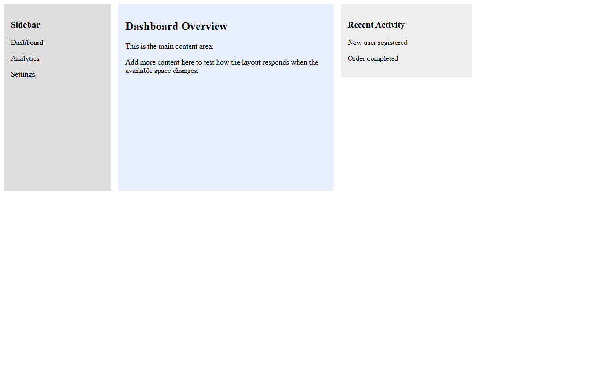
</a>

---

### 15. Question 4: Team Member Profiles
<a href="https://amit-kumar-08.github.io/CSS-ASSIGNMENT/Q4/q4.html">
  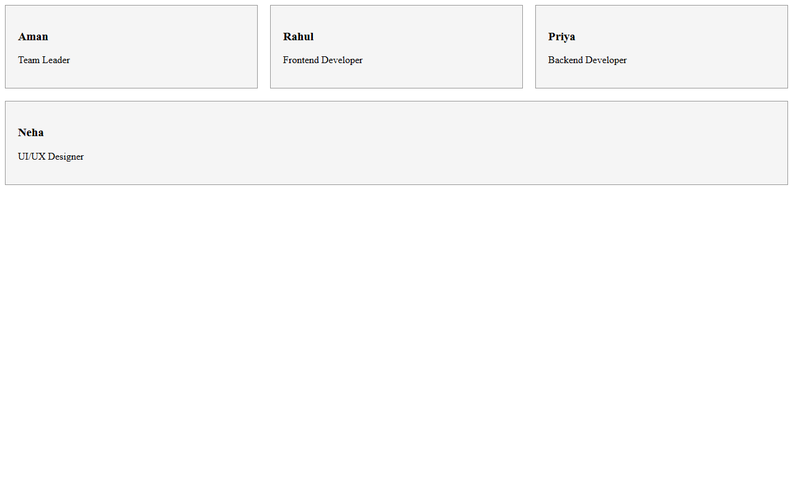
</a>

---

### 16. Question 5: Web App Layout
<a href="https://amit-kumar-08.github.io/CSS-ASSIGNMENT/Q5/q5.html">
  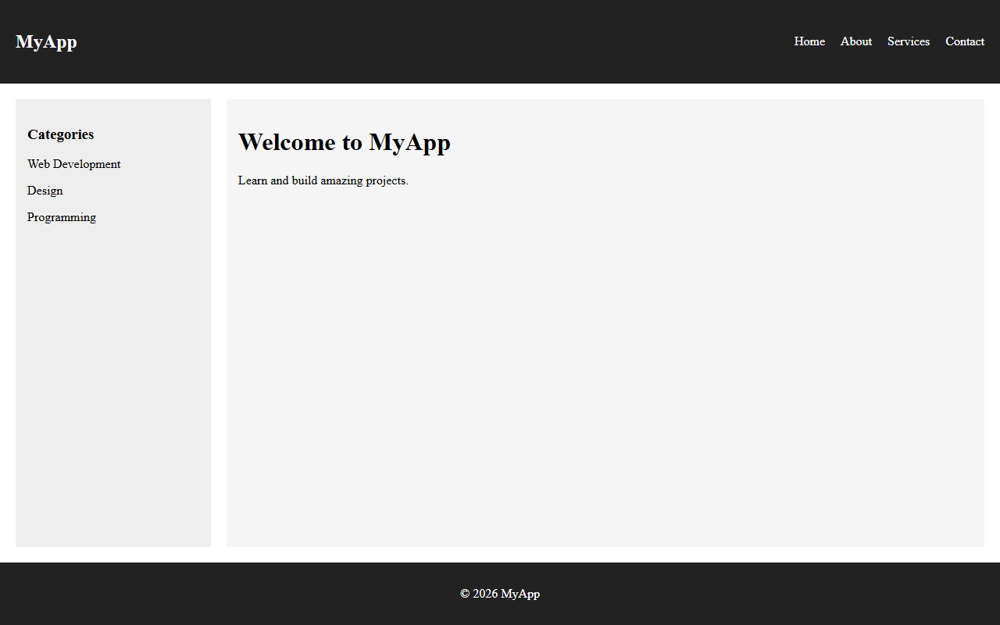
</a>
